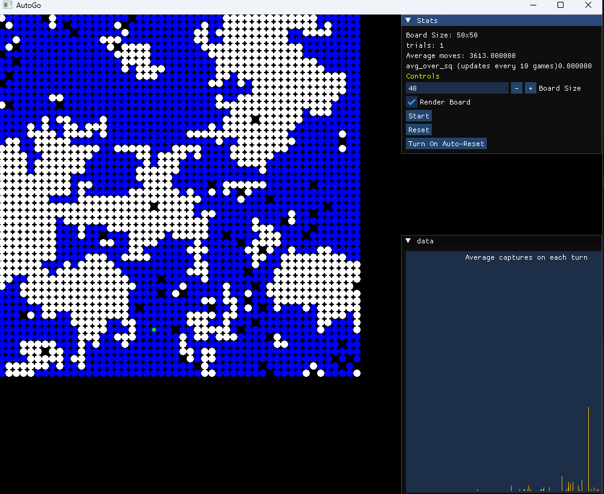
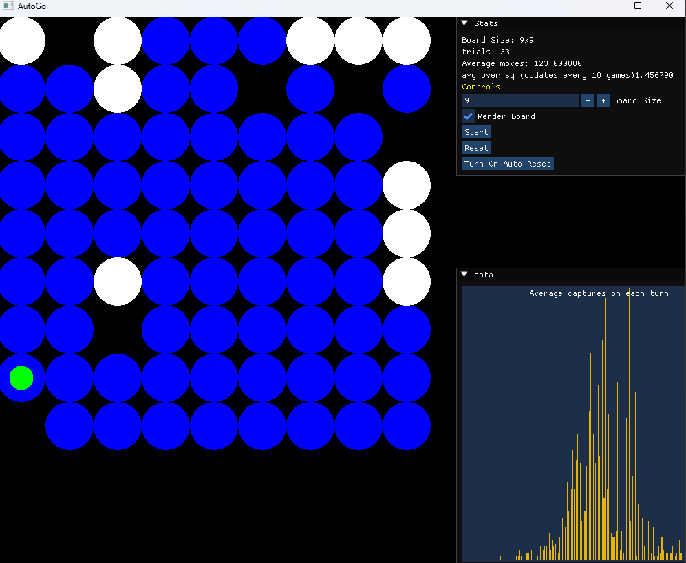

# Auto-Go

A SFML program that simulates games of go with each move chosen at random. The game continues until one side cannot make a legal move on their turn.
Ko rule is enforced, board size is customisable. Gui implemented using [Dear ImGui](https://github.com/ocornut/imgui). 

I built this application because I was interested in the question:

_When playing games of Go on an n*n board where moves are chosen randomly, what is the average number of moves before a player cannot play a legal move?_

The application tracks the number of moves made over multiple games to help answer this question. Rendering can be disabled to speed up the program if desired.

The program is satisfying to watch, particularly on larger board sizes, and often the final game boards end up resembling a continental map. 

Non-square board sizes can be used, but have not been tested and may not work properly.

## Screenshots

